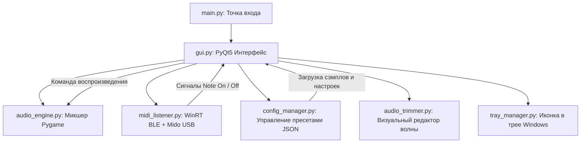

# 🎹 JAMJUM Pad Launcher

**Высокопроизводительный плеер сэмплов и подложек (Live Performance Pad Audio Engine)** с поддержкой аппаратных MIDI-контроллеров по **Native Bluetooth Low Energy (BLE) MIDI** и **USB MIDI**.

Разработано специально для сценических выступлений, интерактивных шоу, диджеинга и ведущих (первично оптимизировано под компактный контроллер **M-Vave / Kuwee JP-MINI**, но легко адаптируется под любой контроллер: Akai, Novation, Arturia, Korg).

---

## 🚀 Основные возможности

- **Двухслойный звуковой движок (Pygame Multi-Channel Audio Engine)**:
  - **Пресет 1 (Ваншоты / One-Shots)**: полифонический запуск эффектов, джинглов, отбивок и барабанов с нулевой задержкой.
  - **Пресет 2 (Треки / Backing Tracks)**: параллельное воспроизведение музыкальных фонов и подложек с управлением Play/Pause/Mute.
  - Независимое управление громкостью для ваншотов и подложек прямо с контроллера (пэды 4, 8, 12, 16) или из интерфейса.
- **Двухрежимный MIDI-драйвер**:
  - **Native Windows BLE MIDI (WinRT GATT)**: прямое подключение к контроллеру по Bluetooth через Windows Runtime API без необходимости сторонних виртуальных портов (MIDIberry, loopMIDI). Реализовано пакетирование с контролем BLE MTU.
  - **Стандартный USB MIDI (Mido + RtMidi)**: автоопределение проводных USB-контроллеров при подключении по кабелю.
- **Физическая привязка аппаратных банков контроллера (Hardware Bank Sync)**:
  - Кнопка **PAD BANK** на контроллере физически переключает подсветку и раскладку:
    - 🔵 **Банк 1 (Голубой / Cyan, ноты 36–51)**: Ваншоты (Пэды 1–12) + Регулировка громкости.
    - 🔴 **Банк 2 (Красный / Red, ноты 52–67)**: Подложки / Треки (Пэды 1–12) + Регулировка громкости.
    - 🟢 **Банк 3 (Зелёный / Green, ноты 68–83)**: Пустой / резервный банк.
- **Встроенный визуальный аудио-триммер (Waveform Trimmer)**:
  - Возможность прямо в приложении обрезать тишину в начале/конце сэмпла, настроить точки зацикливания (Loop) и сохранить отредактированный файл.
- **Система пресетов (Sample Kits)**:
  - Создание неограниченного числа наборов сэмплов с мгновенным переключением во время выступления.
- **Сворачивание в системный трей (System Tray)**:
  - Приложение может играть в фоне с заблокированным или свёрнутым окном.

---

## 🏗 Архитектура проекта



### Структура файлов

```text
Gussy_DAW/
├── main.py                     # Точка входа, инициализация приложения и темы
├── gui.py                      # Главное окно (PyQt5), сетка пэдов, регуляторы громкости
├── audio_engine.py             # Звуковой движок (воспроизведение, каналы, стоп/пауза)
├── midi_listener.py            # Драйвер WinRT BLE MIDI и USB Mido с автопоиском
├── config_manager.py           # Менеджер пресетов (config.json и presets/*.json)
├── audio_trimmer.py            # Диалог редактирования и обрезки звуковых файлов
├── tray_manager.py             # Интеграция с треем Windows (сворачивание, меню)
├── presets/                    # Папка с JSON-файлами наборов сэмплов
│   └── default.json            # Пресет по умолчанию
├── samples/                    # Папка со стандартными звуками и демо-сэмплами
├── requirements.txt            # Список зависимостей Python
├── JAMJUM_Pad_Launcher.spec   # Конфигурация для сборки в единый .EXE через PyInstaller
└── app_icon.ico                # Иконка приложения
```

---

## 🛠 Быстрый старт для разработчика

### 1. Требования
- **ОС**: Windows 10 (версия 1809+) или Windows 11 (требуется для работы Native WinRT BLE).
- **Python**: 3.10 или 3.11 (рекомендуется 64-bit).

### 2. Установка зависимостей

Склонируйте репозиторий и создайте виртуальное окружение:

```powershell
# Клонирование репозитория
git clone <URL_РЕПОЗИТОРИЯ>
cd Gussy_DAW

# Создание и активация виртуального окружения
python -m venv venv
.\venv\Scripts\activate

# Установка зависимостей
pip install -r requirements.txt
```

### 3. Запуск приложения

```powershell
python main.py
```

---

## 🔌 Подключение контроллера (M-Vave / Kuwee JP-MINI)

### По Bluetooth (Беспроводной режим):
1. Включите контроллер тумблером питания.
2. В параметрах Windows перейдите в **Параметры → Bluetooth и устройства → Добавить устройство**.
3. Выберите **Bluetooth** и найдите `JP-Mini` (или ваше BLE MIDI устройство), нажмите **Подключить**.
4. Запустите приложение `JAMJUM Pad Launcher`. Оно автоматически обнаружит спаренное устройство, подключится к GATT-характеристике MIDI и отобразит статус `● Bluetooth: JP-Mini`.

### По USB (Проводной режим):
1. Подключите контроллер стандартным USB Type-C кабелем к компьютеру.
2. Приложение автоматически подхватит контроллер через порт `Mido`.

---

## ⚙️ Руководство по кастомизации под себя

### 1. Как изменить раскладку нот контроллера
Если у вас другой контроллер (например, Akai LPD8 или Launchpad), откройте [midi_listener.py](file:///midi_listener.py):
- Найдите словарь `NOTE_TO_PAD_OFFSET` или обработчик входящих сообщений:
  - Ноты `36..51` по умолчанию соответствуют Bank 1 (Ваншоты).
  - Ноты `52..67` соответствуют Bank 2 (Треки).
  - Ноты `68..83` соответствуют Bank 3 (Пустой).
- Вы можете изменить номера нот под фабричные пресеты вашего контроллера в методе `_process_note_on`:
  ```python
  # Пример: если ваш контроллер шлёт ноты от 0 до 15
  if 0 <= note <= 15:
      pad_index = note
      self.note_on.emit(pad_index, velocity)
  ```

### 2. Как изменить назначение служебных кнопок
В файле [gui.py](file:///gui.py) в методе `handle_controller_button(self, btn_type)` настроена реакция на кнопки контроллера:
- `PLAY_PAUSE`: переключает воспроизведение фонового трека.
- `STOP_ALL`: глушит все звучащие ваншоты.
- `PRESET_TOGGLE`: переключает вкладки пресетов.

### 3. Как изменить цвета и оформление
Все стили оформления (QSS / Qt Style Sheets) вынесены в [gui.py](file:///gui.py):
- Палитра: киберпанк/темный неон (фон `#0d1117`, акценты `#00ffff` Cyan, `#ff007f` Pink, `#00e676` Green, `#7928ca` Purple).
- Цвета пэдов и эффекты нажатия настраиваются в классе `PadWidget`.

### 4. Где хранятся настройки и пресеты
- Основной конфиг: `config.json` (последний выбранный пресет, настройки громкости).
- Наборы звуков: папка `presets/*.json`. Структура файла проста:
  ```json
  {
    "name": "Основной",
    "one_shots": {
      "0": "C:\\path\\to\\kick.wav",
      "1": "C:\\path\\to\\snare.wav"
    },
    "backing_tracks": {
      "0": "C:\\path\\to\\loop.wav"
    }
  }
  ```

---

## 📦 Сборка автономного .EXE для Windows

Приложение можно собрать в переносимый исполняемый `.exe` файл (не требующий установленного Python на компьютере пользователя):

```powershell
pyinstaller JAMJUM_Pad_Launcher.spec
```

Готовый билд появится в директории `dist/JAMJUM_Pad_Launcher/`.

---

## 📄 Лицензия и авторство

Разработано для проекта **Гуси / JAMJUM**.
Любые модификации приветствуются! Настройте проект под ваш сетап и наслаждайтесь безупречным живым звуком! 🎧✨
